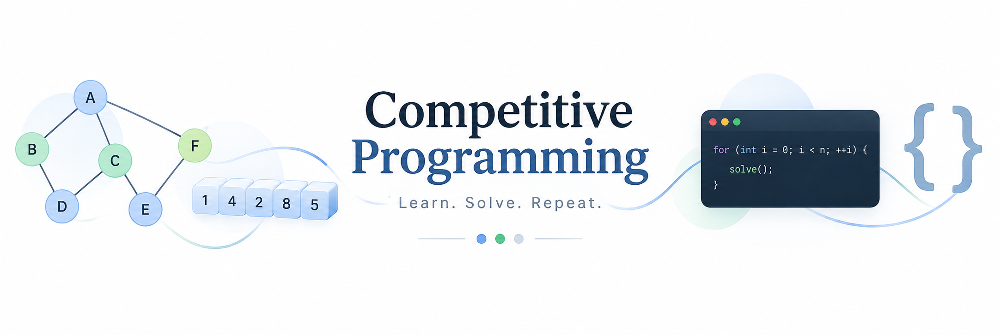

# Competitive Programming


[](https://leetcode.com/)
[](https://codeforces.com/)

A collection of my solutions to problems from LeetCode and Codeforces.

I'm using this repository to improve my problem-solving skills, learn data structures and algorithms, and get better at C++.

## Structure

```text
competitive-programming/
├── leetcode/
│   └── contests/
│       ├── weekly/
│       │   └── 522/
│       └── biweekly/
│           └── 193/
└── codeforces/
    └── codeforces_rouds/
        ├── 1124-div3/
        └── 1129-div2/
```

## Platforms

### LeetCode

I'm following curated problems such as LeetCode 75 to learn common data structures, algorithms, and problem-solving patterns.

### Codeforces

I'm solving beginner problems and gradually increasing the difficulty as I become more comfortable with competitive programming.

## Goals

- Improve my C++ skills
- Learn common data structures and algorithms
- Recognize problem-solving patterns
- Improve my ability to solve problems independently
- Participate in Codeforces contests

## Progress

### LeetCode

| Problem | Topic | Solution |
|---|---|---|
| [1. Two Sum](https://leetcode.com/problems/two-sum/) | Hash Map | [C++](leetcode/01-two_sum.cpp) |
| [2. Add Two Numbers](https://leetcode.com/problems/add-two-numbers/) | Linked List / Math | [C++](leetcode/2-add_two_numbers.cpp) |
| [17. Letter Combinations of a Phone Number](https://leetcode.com/problems/letter-combinations-of-a-phone-number/) | Strings / Backtracking | [C++](leetcode/17-letter_combinations_of_a_phone_number.cpp) |
| [20. Valid Parentheses](https://leetcode.com/problems/valid-parentheses/) | Strings / Stack | [C++](leetcode/20-valid_parentheses.cpp) |
| [22. Generate Parentheses](https://leetcode.com/problems/generate-parentheses/) | Strings / Backtracking | [C++](leetcode/22-generate_parentheses.cpp) |
| [32. Longest Valid Parentheses](https://leetcode.com/problems/longest-valid-parentheses/) | Strings / Stack | [C++](leetcode/32-longest_valid_parentheses.cpp) |
| [49. Group Anagrams](https://leetcode.com/problems/group-anagrams/) | Strings / Hash Map / Counting | [C++](leetcode/49-group_anagrams.cpp) |
| [62. Unique Paths](https://leetcode.com/problems/unique-paths/) | Dynamic Programming | [C++](leetcode/62-unique_paths.cpp) |
| [72. Edit Distance](https://leetcode.com/problems/edit-distance/) | Strings / Dynamic Programming | [C++](leetcode/72-edit_distance.cpp) |
| [104. Maximum Depth of Binary Tree](https://leetcode.com/problems/maximum-depth-of-binary-tree/) | Binary Tree / DFS | [C++](leetcode/104-maximum_depth_binary_tree.cpp) |
| [136. Single Number](https://leetcode.com/problems/single-number/) | Arrays / Bit Manipulation | [C++](leetcode/136-single_number.cpp) |
| [151. Reverse Words in a String](https://leetcode.com/problems/reverse-words-in-a-string/) | Strings / Two Pointers | [C++](leetcode/152-reverse_words_in_a_string.cpp) |
| [162. Find Peak Element](https://leetcode.com/problems/find-peak-element/) | Arrays / Binary Search | [C++](leetcode/162-find_peak_element.cpp) |
| [198. House Robber](https://leetcode.com/problems/house-robber/) | Arrays / Dynamic Programming | [C++](leetcode/198-house_robber.cpp) |
| [199. Binary Tree Right Side View](https://leetcode.com/problems/binary-tree-right-side-view/) | Binary Tree / BFS | [C++](leetcode/199-binary_tree_right_side_view.cpp) |
| [206. Reverse Linked List](https://leetcode.com/problems/reverse-linked-list/) | Linked List | [C++](leetcode/206-reverse_linked_list.cpp) |
| [208. Implement Trie (Prefix Tree)](https://leetcode.com/problems/implement-trie-prefix-tree/) | Trie / Design | [C++](leetcode/208-implement_trie_prefix_tree.cpp) |
| [215. Kth Largest Element in an Array](https://leetcode.com/problems/kth-largest-element-in-an-array/) | Arrays / Selection | [C++](leetcode/215-kth_largest_element_in_an_array.cpp) |
| [216. Combination Sum III](https://leetcode.com/problems/combination-sum-iii/) | Backtracking | [C++](leetcode/216-combination_sum_iii.cpp) |
| [217. Contains Duplicate](https://leetcode.com/problems/contains-duplicate/) | Arrays / Hash Set | [C++](leetcode/217-contains_duplicate.cpp) |
| [236. Lowest Common Ancestor of a Binary Tree](https://leetcode.com/problems/lowest-common-ancestor-of-a-binary-tree/) | Binary Tree / DFS | [C++](leetcode/236-lowest_common_ancestor_binary_tree.cpp) |
| [242. Valid Anagram](https://leetcode.com/problems/valid-anagram/) | Strings / Counting | [C++](leetcode/242-valid_anagram.cpp) |
| [283. Move Zeroes](https://leetcode.com/problems/move-zeroes/) | Arrays / Two Pointers | [C++](leetcode/283-move_zeroes.cpp) |
| [328. Odd Even Linked List](https://leetcode.com/problems/odd-even-linked-list/) | Linked List / Two Pointers | [C++](leetcode/328-odd_even_linked_list.cpp) |
| [334. Increasing Triplet Subsequence](https://leetcode.com/problems/increasing-triplet-subsequence/) | Arrays / Greedy | [C++](leetcode/334-increasing_triplet_subsequence.cpp) |
| [338. Counting Bits](https://leetcode.com/problems/counting-bits/) | Bit Manipulation / Dynamic Programming | [C++](leetcode/338-counting_bits.cpp) |
| [345. Reverse Vowels of a String](https://leetcode.com/problems/reverse-vowels-of-a-string/) | Strings / Two Pointers | [C++](leetcode/345-reverse_vowels_of_a_string.cpp) |
| [347. Top K Frequent Elements](https://leetcode.com/problems/top-k-frequent-elements/) | Arrays / Hash Map / Bucket Sort | [C++](leetcode/347-top_k_frequent_elements.cpp) |
| [374. Guess Number Higher or Lower](https://leetcode.com/problems/guess-number-higher-or-lower/) | Binary Search | [C++](leetcode/374-guess_number_higher_or_lower.cpp) |
| [392. Is Subsequence](https://leetcode.com/problems/is-subsequence/) | Strings / Two Pointers | [C++](leetcode/392-is_subsequence.cpp) |
| [394. Decode String](https://leetcode.com/problems/decode-string/) | Strings / Stack | [C++](leetcode/394-decode_string.cpp) |
| [399. Evaluate Division](https://leetcode.com/problems/evaluate-division/) | Graph / DFS | [C++](leetcode/399-evaluate_division.cpp) |
| [435. Non-overlapping Intervals](https://leetcode.com/problems/non-overlapping-intervals/) | Arrays / Sorting / Greedy | [C++](leetcode/435-non_overlapping_intervals.cpp) |
| [437. Path Sum III](https://leetcode.com/problems/path-sum-iii/) | Binary Tree / DFS | [C++](leetcode/437-path_sum_lll.cpp) |
| [443. String Compression](https://leetcode.com/problems/string-compression/) | Strings / Two Pointers | [C++](leetcode/443-string_compression.cpp) |
| [450. Delete Node in a BST](https://leetcode.com/problems/delete-node-in-a-bst/) | Binary Search Tree / Recursion | [C++](leetcode/450-delete_node_in_a_bst.cpp) |
| [452. Minimum Number of Arrows to Burst Balloons](https://leetcode.com/problems/minimum-number-of-arrows-to-burst-balloons/) | Arrays / Sorting / Greedy | [C++](leetcode/452-minimum_number_of_arrows_to_burst_balloons.cpp) |
| [547. Number of Provinces](https://leetcode.com/problems/number-of-provinces/) | Graph / DFS | [C++](leetcode/547-number_of_provinces.cpp) |
| [605. Can Place Flowers](https://leetcode.com/problems/can-place-flowers/) | Arrays / Greedy | [C++](leetcode/605-can_place_flowers.cpp) |
| [643. Maximum Average Subarray I](https://leetcode.com/problems/maximum-average-subarray-i/) | Arrays / Sliding Window | [C++](leetcode/643-maximum_average_subarray.cpp) |
| [649. Dota2 Senate](https://leetcode.com/problems/dota2-senate/) | Queue / Greedy / Simulation | [C++](leetcode/649-dota2_senate.cpp) |
| [678. Valid Parenthesis String](https://leetcode.com/problems/valid-parenthesis-string/) | Strings / Greedy | [C++](leetcode/678-valid_parenthesis_string.cpp) |
| [700. Search in a Binary Search Tree](https://leetcode.com/problems/search-in-a-binary-search-tree/) | Binary Search Tree | [C++](leetcode/700-search_in_a_binary_search_tree.cpp) |
| [714. Best Time to Buy and Sell Stock with Transaction Fee](https://leetcode.com/problems/best-time-to-buy-and-sell-stock-with-transaction-fee/) | Arrays / Dynamic Programming | [C++](leetcode/714-best_time_to_buy_and_sell_stock_with_transaction_fee.cpp) |
| [724. Find Pivot Index](https://leetcode.com/problems/find-pivot-index/) | Arrays / Prefix Sum | [C++](leetcode/724-find_pivot_index.cpp) |
| [735. Asteroid Collision](https://leetcode.com/problems/asteroid-collision/) | Stack / Simulation | [C++](leetcode/735-asteroid_collision.cpp) |
| [739. Daily Temperatures](https://leetcode.com/problems/daily-temperatures/) | Arrays / Monotonic Stack | [C++](leetcode/739-daily_temperatures.cpp) |
| [746. Min Cost Climbing Stairs](https://leetcode.com/problems/min-cost-climbing-stairs/) | Arrays / Dynamic Programming | [C++](leetcode/746-min_cost_climbing_stairs.cpp) |
| [790. Domino and Tromino Tiling](https://leetcode.com/problems/domino-and-tromino-tiling/) | Dynamic Programming | [C++](leetcode/790-domino_and_tromino_tiling.cpp) |
| [841. Keys and Rooms](https://leetcode.com/problems/keys-and-rooms/) | Graph / DFS | [C++](leetcode/841-keys_and_rooms.cpp) |
| [856. Score of Parentheses](https://leetcode.com/problems/score-of-parentheses/) | Strings / Stack | [C++](leetcode/856-score_of_parentheses.cpp) |
| [872. Leaf-Similar Trees](https://leetcode.com/problems/leaf-similar-trees/) | Binary Tree / DFS | [C++](leetcode/872-leaf_similar_trees.cpp) |
| [875. Koko Eating Bananas](https://leetcode.com/problems/koko-eating-bananas/) | Arrays / Binary Search | [C++](leetcode/875-koko_eating_bananas.cpp) |
| [901. Online Stock Span](https://leetcode.com/problems/online-stock-span/) | Monotonic Stack / Design | [C++](leetcode/901-online_stock_span.cpp) |
| [921. Minimum Add to Make Parentheses Valid](https://leetcode.com/problems/minimum-add-to-make-parentheses-valid/) | Strings / Greedy | [C++](leetcode/921-minimum_add_to_make_parentheses_valid.cpp) |
| [933. Number of Recent Calls](https://leetcode.com/problems/number-of-recent-calls/) | Queue / Sliding Window | [C++](leetcode/933-number_of_recent_calls.cpp) |
| [994. Rotting Oranges](https://leetcode.com/problems/rotting-oranges/) | Matrix / BFS | [C++](leetcode/994-rotting_oranges.cpp) |
| [1021. Remove Outermost Parentheses](https://leetcode.com/problems/remove-outermost-parentheses/) | Strings / Counting | [C++](leetcode/1021-remove_outermost_parentheses.cpp) |
| [1071. Greatest Common Divisor of Strings](https://leetcode.com/problems/greatest-common-divisor-of-strings/) | Strings / GCD | [C++](leetcode/1071-greatest_common_divisor_of_strings.cpp) |
| [1137. N-th Tribonacci Number](https://leetcode.com/problems/n-th-tribonacci-number/) | Dynamic Programming | [C++](leetcode/1137-n_th_tribonacci_number.cpp) |
| [1143. Longest Common Subsequence](https://leetcode.com/problems/longest-common-subsequence/) | Strings / Dynamic Programming | [C++](leetcode/1143-longest_common_subsequence.cpp) |
| [1161. Maximum Level Sum of a Binary Tree](https://leetcode.com/problems/maximum-level-sum-of-a-binary-tree/) | Binary Tree / BFS | [C++](leetcode/1161-maximum_level_sum_binary_tree.cpp) |
| [1254. Number of Closed Islands](https://leetcode.com/problems/number-of-closed-islands/) | Matrix / DFS / Flood Fill | [C++](leetcode/1254-number_of_closed_inslands.cpp) |
| [1268. Search Suggestions System](https://leetcode.com/problems/search-suggestions-system/) | Strings / Sorting / Binary Search | [C++](leetcode/1268-search_suggestions_system.cpp) |
| [1318. Minimum Flips to Make a OR b Equal to c](https://leetcode.com/problems/minimum-flips-to-make-a-or-b-equal-to-c/) | Bit Manipulation | [C++](leetcode/1318-minimum_flips_to_make_a_or_b_equal_to_c.cpp) |
| [1372. Longest ZigZag Path in a Binary Tree](https://leetcode.com/problems/longest-zigzag-path-in-a-binary-tree/) | Binary Tree / DFS | [C++](leetcode/1372-longest_zigzag_path_binary_tree.cpp) |
| [1431. Kids With the Greatest Number of Candies](https://leetcode.com/problems/kids-with-the-greatest-number-of-candies/) | Arrays | [C++](leetcode/1431-kids_with_the_greatest_number.cpp) |
| [1448. Count Good Nodes in Binary Tree](https://leetcode.com/problems/count-good-nodes-in-binary-tree/) | Binary Tree / DFS | [C++](leetcode/1448-count_good_nodes_binary_tree.cpp) |
| [1456. Maximum Number of Vowels in a Substring of Given Length](https://leetcode.com/problems/maximum-number-of-vowels-in-a-substring-of-given-length/) | Strings / Sliding Window | [C++](leetcode/1456-maximun_number_of_vowels.cpp) |
| [1466. Reorder Routes to Make All Paths Lead to the City Zero](https://leetcode.com/problems/reorder-routes-to-make-all-paths-lead-to-the-city-zero/) | Graph / DFS | [C++](leetcode/1466-reorder_routes_to_make_all_paths_lead_to_the_city_zero.cpp) |
| [1493. Longest Subarray of 1's After Deleting One Element](https://leetcode.com/problems/longest-subarray-of-1s-after-deleting-one-element/) | Arrays / Sliding Window | [C++](leetcode/1493-longest_subarray_of_1.cpp) |
| [1541. Minimum Insertions to Balance a Parentheses String](https://leetcode.com/problems/minimum-insertions-to-balance-a-parentheses-string/) | Strings / Greedy | [C++](leetcode/1541-minimum_insertations_to_balance_a_parentheses.cpp) |
| [1569. Number of Ways to Reorder Array to Get Same BST](https://leetcode.com/problems/number-of-ways-to-reorder-array-to-get-same-bst/) | Binary Search Tree / Combinatorics / Recursion | [C++](leetcode/1569-number_of_ways_to_reorder_array_to_get_same_bst.cpp) |
| [1657. Determine if Two Strings Are Close](https://leetcode.com/problems/determine-if-two-strings-are-close/) | Strings / Counting / Sorting | [C++](leetcode/1657-determine_if_two_string_are_close.cpp) |
| [1732. Find the Highest Altitude](https://leetcode.com/problems/find-the-highest-altitude/) | Arrays / Prefix Sum | [C++](leetcode/1732-find_the_highest_altitude.cpp) |
| [1768. Merge Strings Alternately](https://leetcode.com/problems/merge-strings-alternately/) | Strings | [C++](leetcode/1768-merge_strings_alternately.cpp) |
| [1926. Nearest Exit from Entrance in Maze](https://leetcode.com/problems/nearest-exit-from-entrance-in-maze/) | Graph / BFS / Matrix | [C++](leetcode/1926-nearest_exit_from_entrance_in_maze.cpp) |
| [2089. Find Target Indices After Sorting Array](https://leetcode.com/problems/find-target-indices-after-sorting-array/) | Arrays / Counting | [C++](leetcode/2089-find_target_indices_after_sorting_array.cpp) |
| [2095. Delete the Middle Node of a Linked List](https://leetcode.com/problems/delete-the-middle-node-of-a-linked-list/) | Linked List / Two Pointers | [C++](leetcode/2095-delete_midlle_node.cpp) |
| [2215. Find the Difference of Two Arrays](https://leetcode.com/problems/find-the-difference-of-two-arrays/) | Arrays / Hash Set | [C++](leetcode/2215-find_the_difference_of_two_arrays.cpp) |
| [2300. Successful Pairs of Spells and Potions](https://leetcode.com/problems/successful-pairs-of-spells-and-potions/) | Arrays / Sorting / Binary Search | [C++](leetcode/2300-successful_pairs_of_spells_and_potions.cpp) |
| [2333. Minimum Sum of Squared Difference](https://leetcode.com/problems/minimum-sum-of-squared-difference/) | Arrays / Binary Search / Greedy | [C++](leetcode/2333-minimum_sum_of_squared_diff.cpp) |
| [2336. Smallest Number in Infinite Set](https://leetcode.com/problems/smallest-number-in-infinite-set/) | Heap / Hash Set / Design | [C++](leetcode/2336-smallest_number_in_infinite_set.cpp) |
| [2352. Equal Row and Column Pairs](https://leetcode.com/problems/equal-row-and-column-pairs/) | Matrices / Enumeration | [C++](leetcode/2352-equal_row_and_column_pairs.cpp) |
| [2390. Removing Stars From a String](https://leetcode.com/problems/removing-stars-from-a-string/) | Strings / Stack | [C++](leetcode/2390-removing_start_from_string.cpp) |
| [2409. Count Days Spent Together](https://leetcode.com/problems/count-days-spent-together/) | Strings / Date Conversion / Intervals | [C++](leetcode/2409-count_days_spent_together.cpp) |
| [2462. Total Cost to Hire K Workers](https://leetcode.com/problems/total-cost-to-hire-k-workers/) | Arrays / Heap / Two Pointers | [C++](leetcode/2462-total_cost_to_hire_k_workers.cpp) |
| [2542. Maximum Subsequence Score](https://leetcode.com/problems/maximum-subsequence-score/) | Arrays / Sorting / Heap / Greedy | [C++](leetcode/2542-maximum_subsequence_score.cpp) |
| [2778. Sum of Squares of Special Elements](https://leetcode.com/problems/sum-of-squares-of-special-elements/) | Arrays / Math | [C++](leetcode/2778-sum_of_square_of_special_element.cpp) |
| [2913. Subarrays Distinct Element Sum of Squares I](https://leetcode.com/problems/subarrays-distinct-element-sum-of-squares-i/) | Arrays / Set / Enumeration | [C++](leetcode/2913-subarrays_disctinc_elements_sqaures.cpp) |
| [2916. Subarrays Distinct Element Sum of Squares II](https://leetcode.com/problems/subarrays-distinct-element-sum-of-squares-ii/) | Arrays / Segment Tree / Lazy Propagation | [C++](leetcode/2916-subarray_distinc_element_sum_sequences.cpp) |
| [3551. Minimum Swaps to Sort by Digit Sum](https://leetcode.com/problems/minimum-swaps-to-sort-by-digit-sum/) | Arrays / Sorting / Cycle Decomposition | [C++](leetcode/3551-minimum_swaps_to_sort.cpp) |
| [3619. Count Islands With Total Value Divisible by K](https://leetcode.com/problems/count-islands-with-total-value-divisible-by-k/) | Matrix / DFS | [C++](leetcode/3619-count_islands_with_total_value_divisible_by_k.cpp) |
| [3644. Maximum K to Sort a Permutation](https://leetcode.com/problems/maximum-k-to-sort-a-permutation/) | Arrays / Bit Manipulation | [C++](leetcode/3644-maximum_k_to_sort_a_permutation.cpp) |
| [3727. Maximum Alternating Sum of Squares](https://leetcode.com/problems/maximum-alternating-sum-of-squares/) | Arrays / Sorting / Greedy | [C++](leetcode/3727-maximum_alternating_sum_of_squares.cpp) |
| [3863. Minimum Operations to Sort a String](https://leetcode.com/problems/minimum-operations-to-sort-a-string/) | Strings / Greedy | [C++](leetcode/3863-minimum_operations_to_sort_a_string.cpp) |
| [3886. Sum of Sortable Integers](https://leetcode.com/problems/sum-of-sortable-integers/) | Arrays / Sorting / Enumeration | [C++](leetcode/3886-sum_of_sortable_integers.cpp) |
| [3942. Minimum Operations to Sort a Permutation](https://leetcode.com/problems/minimum-operations-to-sort-a-permutation/) | Arrays / Math | [C++](leetcode/3942-minimum_operations_to_sort_a_permutation.cpp) |
| [3963. Create Grid With Exactly One Path](https://leetcode.com/problems/create-grid-with-exactly-one-path/) | Matrix / Construction | [C++](leetcode/3963-create_grid_with_exactly_one_path.cpp) |
| [Minimum Rotations to Dial a Number I](https://leetcode.com/problems/minimum-rotations-to-dial-a-number-i/) (Weekly Contest 522) | Strings / Greedy | [C++](leetcode/contests/weekly/522/01-minimum_rotation_to_dial_1.cpp) |
| [Minimum Rotations to Dial a Number II](https://leetcode.com/problems/minimum-rotations-to-dial-a-number-ii/) (Weekly Contest 522) | Strings / Enumeration | [C++](leetcode/contests/weekly/522/02-minimum_rotation_to_dial_2.cpp) |
| [Maximum Product Pair With Target Sum](https://leetcode.com/contest/biweekly-contest-193/problems/maximum-product-pair-with-target-sum/) (Biweekly Contest 193) | Arrays / Hash Map | [C++](leetcode/contests/biweekly/193/q1.cpp) |
| [Longest Resilient Subarray I](https://leetcode.com/contest/biweekly-contest-193/problems/longest-resilient-subarray-i/) (Biweekly Contest 193) | Arrays / Math / GCD | [C++](leetcode/contests/biweekly/193/q2.cpp) |
| [Longest Resilient Subarray II](https://leetcode.com/contest/biweekly-contest-193/problems/longest-resilient-subarray-ii/) (Biweekly Contest 193) | Arrays / Math / GCD | [C++](leetcode/contests/biweekly/193/q3.cpp) |
| [Minimize Inversions in a Prefix Tree](https://leetcode.com/contest/biweekly-contest-193/problems/minimize-inversions-in-a-prefix-tree/) (Biweekly Contest 193) | Trie / Bitmask DP | [C++](leetcode/contests/biweekly/193/q4.cpp) |

### Codeforces

| Problem | Topic | Solution |
|---|---|---|
| [4A. Watermelon](https://codeforces.com/contest/4/problem/A) | Math / Conditions | [C++](codeforces/4a-watermelon.cpp) |
| [33A. What is for dinner?](https://codeforces.com/problemset/problem/33/A) | Arrays / Greedy | [C++](codeforces/33a-what_is_for_dinner.cpp) |
| [50A. Domino piling](https://codeforces.com/problemset/problem/50/A) | Math / Greedy | [C++](codeforces/50a-domino_poling.cpp) |
| [69A. Young Physicist](https://codeforces.com/problemset/problem/69/A) | Math / Vectors | [C++](codeforces/69a-young_physicist.cpp) |
| [71A. Way Too Long Words](https://codeforces.com/problemset/problem/71/A) | Strings | [C++](codeforces/71a-way_too_long_words.cpp) |
| [112A. Petya and Strings](https://codeforces.com/problemset/problem/112/A) | Strings / Comparison | [C++](codeforces/112a-petya_and_strigs.cpp) |
| [158A. Next Round](https://codeforces.com/problemset/problem/158/A) | Counting / Conditions | [C++](codeforces/158a-next_round.cpp) |
| [218B. Airport](https://codeforces.com/problemset/problem/218/B) | Heap / Greedy | [C++](codeforces/218b-airport.cpp) |
| [231A. Team](https://codeforces.com/problemset/problem/231/A) | Counting / Conditions | [C++](codeforces/231a-team.cpp) |
| [236A. Boy or Girl](https://codeforces.com/problemset/problem/236/A) | Strings / Counting | [C++](codeforces/236a-boy_or_girl.cpp) |
| [263A. Beautiful Matrix](https://codeforces.com/problemset/problem/263/A) | Matrices / Math | [C++](codeforces/263A-beautiful_matrix.cpp) |
| [271A. Beautiful Year](https://codeforces.com/problemset/problem/271/A) | Math / Enumeration / Counting | [C++](codeforces/271a-beautiful_year.cpp) |
| [281A. Word Capitalization](https://codeforces.com/problemset/problem/281/A) | Strings | [C++](codeforces/281a-word_capitalization.cpp) |
| [282A. Bit++](https://codeforces.com/problemset/problem/282/A) | Strings / Simulation | [C++](codeforces/282a-bit++.cpp) |
| [339A. Helpful Maths](https://codeforces.com/problemset/problem/339/A) | Strings / Sorting | [C++](codeforces/339a-helpful_maths.cpp) |
| [1691E. Number of Groups](https://codeforces.com/problemset/problem/1691/E) | Sorting / Sweep Line / Disjoint Set Union | [C++](codeforces/1691e-number_of_groups.cpp) |
| [1861C. Queries for the Array](https://codeforces.com/problemset/problem/1861/C) | Strings / Greedy / Simulation | [C++](codeforces/1861c-queries_for_the_array.cpp) |
| [1913B. Swap and Delete](https://codeforces.com/problemset/problem/1913/B) | Strings / Counting / Greedy | [C++](codeforces/1913b-swap_and_delete.cpp) |
| [2232B. Cake Leveling](https://codeforces.com/problemset/problem/2232/B) | Prefix Sum / Greedy | [C++](codeforces/2232b-cake_leveling.cpp) |
| [2256B. Domino Tiles](https://codeforces.com/problemset/problem/2256/B) | Strings / Enumeration | [C++](codeforces/2256b-domino_tiles.cpp) |
| [2258A. Odd Eraser](https://codeforces.com/problemset/problem/2258/A) | Math / GCD | [C++](codeforces/2258a-odd_eraser.cpp) |
| [2258B1. Carrot Chopdown](https://codeforces.com/problemset/problem/2258/B1) | Counting / Prefix Sum / Enumeration | [C++](codeforces/2258b1-carrot_chopdown.cpp) |
| [2258D. Magic Tiles](https://codeforces.com/problemset/problem/2258/D) | Sweep Line / Dynamic Programming | [C++](codeforces/2258d-magic_tiles.cpp) |
| [2258E. DivMEX](https://codeforces.com/problemset/problem/2258/E) | Number Theory / Sieve / Segment Tree | [C++](codeforces/2258e-divMEX.cpp) |
| [2264B. Knife's Pill Farm](https://codeforces.com/problemset/problem/2264/B) | Heap / Greedy | [C++](codeforces/2264b-knifes_pill_farm.cpp) |
| [2266C. AND OR Sort](https://codeforces.com/problemset/problem/2266/C) | Strings / Prefix Counts / Enumeration | [C++](codeforces/2266c-and_or_sort.cpp) |
| [2269B. Kiakio and Square Numbers](https://codeforces.com/problemset/problem/2269/B) | Math / Simulation / Counting | [C++](codeforces/2269b-kiakio_and_square_numbers.cpp) |
| [2271A. Robot Odd Moves](https://codeforces.com/contest/2271/problem/A) | Math / Parity | [C++](codeforces/2271a-robot_odd_moves.cpp) |
| [2277A. Subset Selecting](https://codeforces.com/contest/2277/problem/A) | Counting / Prefix Sum / Greedy | [C++](codeforces/codeforces_rouds/1129-div2/a.cpp) |
| [2277B. Sequence Decreasing](https://codeforces.com/contest/2277/problem/B) | Arrays / Minimum / Conditions | [C++](codeforces/codeforces_rouds/1129-div2/b.cpp) |
| [2277C. Edge Addeleting](https://codeforces.com/contest/2277/problem/C) | Tree / BFS / Distances | [C++](codeforces/codeforces_rouds/1129-div2/c.cpp) |
| [2277D1. Number Operating (Easy Version)](https://codeforces.com/contest/2277/problem/D1) | Math / Greedy / Enumeration | [C++](codeforces/codeforces_rouds/1129-div2/d1.cpp) |
| [2277D2. Number Operating (Hard Version)](https://codeforces.com/contest/2277/problem/D2) | Math / Recursion / Prefix Sum | [C++](codeforces/codeforces_rouds/1129-div2/d2.cpp) |
| [2277F. Token Re-Moving](https://codeforces.com/contest/2277/problem/F) | Tree / Disjoint Set Union / Subtree Sums | [C++](codeforces/codeforces_rouds/1129-div2/f.cpp) |
| 1124-div3 / A | Geometry / Construction | [C++](codeforces/codeforces_rouds/1124-div3/a.cpp) |
| 1124-div3 / B | Stack / Simulation | [C++](codeforces/codeforces_rouds/1124-div3/b.cpp) |
| 1124-div3 / C | Hash Map / Counting | [C++](codeforces/codeforces_rouds/1124-div3/c.cpp) |
| 1124-div3 / D | Binary Search / Greedy | [C++](codeforces/codeforces_rouds/1124-div3/d.cpp) |

The `1124-div3` entries use the local folder label; contest details and problem links are pending verification.
